<div align="center">

# Vexel-plugins

**De openbare plugins voor Vexel: kleine uitbreidingen die iedereen kan maken.**

[Bekijk de galerij](https://guuslab.github.io/vexel-plugins/) ·
[Een plugin maken](#een-plugin-maken-in-5-minuten) ·
[De API](docs/api.md) ·
[Bijdragen](CONTRIBUTING.md)

</div>

> **In English.** This is the public plugin repository for Vexel. A plugin is
> one plain JavaScript file plus a small manifest. It runs in a sandbox with no
> network and talks to Vexel only through a small API. Everything here is
> written in Dutch, but contributions in English are welcome too: open a pull
> request with your plugin in `plugins/<id>/`, CI checks it automatically, a
> maintainer reviews the code, and once merged it is live within minutes.
> Start with [docs/api.md](docs/api.md) and [CONTRIBUTING.md](CONTRIBUTING.md).

---

## Wat is dit?

Een plugin voegt een commando toe aan Vexel: een raster tekenen, kleuren
zoeken die bij elkaar passen, een patroon maken. Elke plugin is één gewoon
JavaScript-bestand, zonder build en zonder afhankelijkheden, met een klein
manifest dat zegt wat hij doet en wat hij mag.

Deze repo is de catalogus. Wat op `main` staat, staat in Vexel.

## Installeren in Vexel

1. Open in Vexel het menu **Plugins › Plugins beheren…**.
2. Kies een plugin. Je ziet wat hij doet, wie hem maakte en precies wat hij
   mag.
3. Klik **Installeren**. De plugin staat daarna in het menu **Plugins**.

Vexel haalt de code zelf op en controleert de sha256 tegen de index. Klopt die
niet, dan weigert Vexel de plugin. Wat je installeert, bewaart Vexel bij
zichzelf, dus een geïnstalleerde plugin blijft werken als deze site even
onbereikbaar is.

## Plugins

81 plugins, per soort.

### Foto's bewerken

| | Plugin | Wat hij doet | Mag |
|---|---|---|---|
|  | [**Dithering**](plugins/dithering) | Zet een foto om in 1-bit of een klein palet met foutverdeling of een geordend raster, met grove of fijne pixels. | selectie lezen, foto's lezen, foto's wijzigen |
| 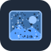 | [**Filmkorrel**](plugins/filmkorrel) | Geef een foto echte, klonterige filmkorrel, fijn of grof, in zwart-wit of kleur. | selectie lezen, foto's lezen, foto's wijzigen |
|  | [**Foto bijwerken**](plugins/foto-bijwerken) | Werk een foto bij met belichting, contrast, hooglichten, schaduwen, warmte, verzadiging en kant-en-klare looks. | selectie lezen, foto's lezen, foto's wijzigen |
|  | [**Glitch**](plugins/glitch) | Geef een foto een digitale storing met verschoven kleurkanalen, verspringende stroken, scanlijnen en ruisblokken. | selectie lezen, foto's lezen, foto's wijzigen |
|  | [**Lichtlek**](plugins/lichtlek) | Zet warme, filmachtige lichtvlekken en gloed langs de rand van een foto, desgewenst met stofjes en krasjes. | selectie lezen, foto's lezen, foto's wijzigen |
|  | [**Pixeleren**](plugins/pixeleren) | Verdeel een foto in blokken, stippen of zeshoeken in de gemiddelde kleur, desgewenst met minder kleuren. | selectie lezen, foto's lezen, foto's wijzigen |
|  | [**Textuur**](plugins/textuur) | Maak een doorzichtige textuurfoto met korrel, papiervezel, vlekken, een rasterpatroon of krassen om over je ontwerp te leggen. | selectie lezen, document wijzigen, foto's wijzigen |
| 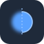 | [**Vervagen en verscherpen**](plugins/scherpte) | Vervaag een foto zacht, verscherp hem met een onscherpmasker of geef hem bewegingsonscherpte onder elke hoek. | selectie lezen, foto's lezen, foto's wijzigen |
|  | [**Vignet**](plugins/vignet) | Maak de randen van een foto zacht donkerder of lichter, met een middelpunt dat je zelf aanklikt. | selectie lezen, foto's lezen, foto's wijzigen |

### Foto naar vector

| | Plugin | Wat hij doet | Mag |
|---|---|---|---|
| 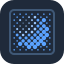 | [**Foto naar halftoon**](plugins/foto-halftoon) | Maak van een foto een echt vectorraster van punten of lijnen, in één kleur of als CMYK-scheiding met de klassieke rasterhoeken. | selectie lezen, foto's lezen, document wijzigen |
|  | [**Lijngravure**](plugins/lijngravure) | Maak van een foto een gravure van rechte of golvende lijnen, cirkels of een spiraal, met een dikte die de donkerte volgt. | selectie lezen, foto's lezen, document wijzigen |
|  | [**Low-poly**](plugins/foto-lowpoly) | Maak van een foto een vlak van driehoeken met de gemiddelde kleur, dichter bij de randen zodat vormen herkenbaar blijven. | selectie lezen, foto's lezen, document wijzigen |
|  | [**Palet uit foto**](plugins/palet-uit-foto) | Haal de hoofdkleuren uit een foto en zet ze als benoemde kleurvlakjes met CMYK- of hexwaarden naast de foto. | selectie lezen, foto's lezen, document wijzigen |
|  | [**Stippelen**](plugins/stippelen) | Maak van een foto een stippeltekening met gelijkmatig verdeelde stippen die dichter staan waar de foto donker is. | selectie lezen, foto's lezen, document wijzigen |
| 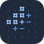 | [**Tekstkunst**](plugins/tekstkunst) | Maak van een foto een raster van letters of tekens, met een eigen tekst of een tekenset, in één kleur of de kleuren van de foto. | selectie lezen, foto's lezen, document wijzigen |

### Vormen

| | Plugin | Wat hij doet | Mag |
|---|---|---|---|
|  | [**Badge**](plugins/badge) | Maak stickers en badges, zoals een prijsster, rozet of schild, met gecentreerde tekst erin. | document wijzigen |
|  | [**Blob**](plugins/blob) | Teken organische blobvormen, los of als compositie van overlappende blobs in een kleurpalet. | document wijzigen |
|  | [**Bonnen en vouchers**](plugins/kortingsbon) | Maak genummerde cadeaubonnen, kortingsbonnen en stempelkaarten in vier stijlen, met afscheurstrook en zoveel per vel als past. | document wijzigen |
|  | [**Doosontwerp**](plugins/doosontwerp) | Teken de stansvorm van een vouwdoos met insteekkleppen, met aparte snij- en rillijnen. | document wijzigen |
| 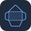 | [**Envelop-ontwerp**](plugins/envelop-ontwerp) | Teken de stansvorm van een papieren envelop in een standaard- of eigen maat, met snij- en rillijnen. | document wijzigen |
|  | [**Extruderen**](plugins/extruderen) | Maak van gesloten vormen een blok met diepte, met zijvlakken die vanzelf donkerder worden naarmate ze van het licht af staan. | selectie lezen, document wijzigen |
|  | [**Fractalboom**](plugins/fractalboom) | Laat een boom, varen, koraal, wilg of bloesemtak groeien uit vertakkende, taps toelopende takken met bladeren of bloesem. | selectie lezen, document wijzigen |
|  | [**Isometrische blokken**](plugins/isometrisch) | Bouw isometrische blokken, trappen en cilinders uit een hoogteraster, in drie tinten van één kleur. | document wijzigen |
|  | [**Linten en banners**](plugins/lint) | Maak linten met omgevouwen uiteinden, gebogen banners, hoeklinten, vaandels en labels met tekst erop. | selectie lezen, document wijzigen |
|  | [**Pijlen**](plugins/pijlen) | Teken verzorgde pijlen als gevulde vormen, of zet een verbindingspijl tussen twee geselecteerde objecten. | selectie lezen, document wijzigen |
|  | [**Raster**](plugins/raster) | Verdeel het tekengebied in kolommen en rijen met gelijke tussenruimte. | document wijzigen |
| 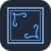 | [**Sierrand**](plugins/sierrand) | Zet een sierlijk kader met hoekornamenten langs het tekengebied of de selectie, voor uitnodigingen en menukaarten. | selectie lezen, document wijzigen |
|  | [**Spelmateriaal**](plugins/dobbelstenen) | Maak dobbelstenen met een vouwbare bouwplaat, speelkaarten met eigen kleursymbolen en een speelbord met genummerde vakken. | document wijzigen |
|  | [**Sterrenhemel**](plugins/sterrenhemel) | Teken een nachtelijke hemel met sterren, twinkels, een melkweg, bekende sterrenbeelden en de maan in de fase die je kiest. | selectie lezen, document wijzigen |
|  | [**Tekstballonnen**](plugins/tekstballon) | Teken spraak-, gedachte-, schreeuw- en fluisterballonnen met een staart die vloeiend in de vorm overloopt. | selectie lezen, document wijzigen |

### Patronen

| | Plugin | Wat hij doet | Mag |
|---|---|---|---|
|  | [**Arcering**](plugins/arcering) | Vul een gesloten vorm met evenwijdige lijnen, kruisarcering, stippels of verlopende lijnen met een gravure-gevoel. | selectie lezen, document wijzigen |
|  | [**Confetti**](plugins/confetti) | Strooi rondjes, strookjes, driehoekjes, kronkels en sterretjes die elkaar niet raken, overal of langs de randen. | selectie lezen, document wijzigen |
| 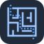 | [**Doolhof**](plugins/doolhof) | Maak een rechthoekig of rond doolhof voor puzzelboekjes en werkbladen, met de oplossing als aparte groep. | document wijzigen |
|  | [**Geometrische compositie**](plugins/geometrische-compositie) | Maak een geometrische compositie in een raster met cirkels, bogen, driehoeken en strepen in een beperkt palet. | document wijzigen |
|  | [**Golven**](plugins/golven) | Vul het tekengebied of je selectie met gestapelde golflijnen of gevulde banden die vloeiend van kleur verlopen. | selectie lezen, document wijzigen |
|  | [**Guilloche**](plugins/guilloche) | Teken een sierrand of medaillon van fijne, in elkaar gevlochten golflijnen, zoals op waardepapier en certificaten. | selectie lezen, document wijzigen |
|  | [**Halftoon**](plugins/halftoon) | Vul het tekengebied of je selectie met een halftoonraster van stippen, vierkantjes, ruiten of lijnen die in grootte verlopen. | selectie lezen, document wijzigen |
|  | [**Korrel**](plugins/korrel) | Maak een spikkel- of stippeltextuur van vectorstippen, met een verloop van dicht naar ijl. | selectie lezen, document wijzigen |
|  | [**Mozaïek**](plugins/mozaiek) | Vul het tekengebied of de selectie met een low-poly- of celmozaïek in een zacht kleurverloop. | selectie lezen, document wijzigen |
|  | [**Papier**](plugins/papier) | Zet lijntjes, ruitjes, stippen, millimeterpapier, een isometrisch raster, zeshoeken of notenbalken op het tekengebied. | document wijzigen |
|  | [**Rolcirkels**](plugins/rolcirkels) | Teken gelaagde rolcirkelfiguren van een wiel dat binnen of buiten een ring rolt, in kleurverloop en als gladde krommen. | selectie lezen, document wijzigen |
|  | [**Rozet**](plugins/rozet) | Teken een sierlijk rozetpatroon als één pad, met instelbare lussen, straal en verhouding. | document wijzigen |
|  | [**Speels patroon**](plugins/speels-patroon) | Vul het tekengebied met een speels patroon in jaren-80-stijl: kronkels, driehoekjes, stippen en zigzagjes. | document wijzigen |
|  | [**Stromingsveld**](plugins/stromingsveld) | Vul het tekengebied of de selectie met gelijk verdeelde, taps toelopende lijnen die een vloeiend stromingsveld volgen. | selectie lezen, document wijzigen |
|  | [**Terrazzo**](plugins/terrazzo) | Vul het tekengebied of de selectie met terrazzo-stenen, confetti-steen of golvende marmer-aders in een eigen palet. | selectie lezen, document wijzigen |
|  | [**Truchet**](plugins/truchet) | Vul het tekengebied of de selectie met een truchetpatroon van kwartbogen, diagonalen of driehoeken. | selectie lezen, document wijzigen |
|  | [**Voronoi-cellen**](plugins/voronoi) | Vul het tekengebied of een vorm met organische, afgeronde cellen met een voeg ertussen, van kiezels tot honingraat. | selectie lezen, document wijzigen |
|  | [**Zonnestralen**](plugins/zonnestralen) | Vul het tekengebied tot in de afloop, of je selectie, met stralen in twee kleuren vanuit een middelpunt. | selectie lezen, document wijzigen |

### Kleur

| | Plugin | Wat hij doet | Mag |
|---|---|---|---|
|  | [**Aura**](plugins/aura) | Vul het tekengebied met zachte, in elkaar overlopende kleurvlekken als achtergrond, helemaal in vectoren. | document wijzigen |
|  | [**Contrastcheck**](plugins/contrastcheck) | Controleer of tekst goed leesbaar is op zijn achtergrond volgens de WCAG-normen en krijg zo nodig een kleur die het wel haalt. | selectie lezen, document wijzigen |
|  | [**Kleurenblindheid**](plugins/kleurenblind) | Bekijk je ontwerp zoals mensen met een vorm van kleurenblindheid het zien en vind kleuren die samenvallen. | selectie lezen, document wijzigen |
| 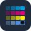 | [**Kleurenkaart**](plugins/kleurenkaart) | Zet een drukproef-kleurenkaart met tintenladders per inkt en een rijk-zwartvergelijking op het tekengebied. | document wijzigen |
|  | [**Kleurharmonie**](plugins/kleurharmonie) | Zet een rij CMYK-kleurvlakjes neer die passen bij de vulkleur van je selectie. | selectie lezen, document wijzigen |

### Tekst en puzzels

| | Plugin | Wat hij doet | Mag |
|---|---|---|---|
|  | [**Bingokaarten**](plugins/bingo) | Maak unieke bingokaarten voor 75 of 90 ballen of met eigen woorden, verdeeld over vellen, met trekkingslijst. | document wijzigen |
|  | [**Blindtekst**](plugins/blindtekst) | Vul een vlak of je tekengebied met natuurlijk ogende Nederlandse opvultekst, netjes afgebroken op de breedte. | selectie lezen, document wijzigen |
|  | [**Kruiswoordraster**](plugins/kruiswoord) | Maak uit je eigen woorden met omschrijvingen een compacte kruiswoordpuzzel met nummers en een verborgen oplossing. | document wijzigen |
|  | [**Nummeren**](plugins/nummeren) | Maak genummerde tickets, bonnen en loten met afscheurstrook en perforatielijn, netjes verdeeld over vellen. | selectie lezen, document wijzigen |
|  | [**Oorkonde**](plugins/oorkonde) | Maak een oorkonde, certificaat of diploma met sierlijke rand, handtekeningen en zegel, in vier stijlen. | document wijzigen |
| 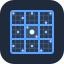 | [**Sudoku**](plugins/sudoku) | Maak sudoku's met precies één oplossing, in vier niveaus en ook 6 × 6, netjes verdeeld over het vel. | document wijzigen |
|  | [**Tabel**](plugins/tabel) | Maak een verzorgde tabel uit geplakte tekst, met kopregel, zebrastrepen, randen en getallen netjes rechts. | document wijzigen |
|  | [**Typeschaal**](plugins/typeschaal) | Maak een specimenblad met een modulaire letterschaal van H1 tot klein, met maten in pt en advies voor de regelafstand. | document wijzigen |
|  | [**Woordzoeker**](plugins/woordzoeker) | Maak een woordzoeker uit je eigen woordenlijst, met de lijst eronder en desgewenst de oplossing. | document wijzigen |

### Ordenen en diagrammen

| | Plugin | Wat hij doet | Mag |
|---|---|---|---|
|  | [**Etiketvel**](plugins/etiketvel) | Zet de contouren van rechthoekige, ronde of ovale etiketten netjes in kolommen en rijen op een vel. | document wijzigen |
| 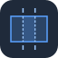 | [**Folder-indeling**](plugins/folder-indeling) | Deel het tekengebied in voor een vouwfolder, met vouwlijnen, vouwtekens en benoemde panelen. | document wijzigen |
|  | [**Gedachtekaart**](plugins/gedachtekaart) | Maak een gedachtekaart met een onderwerp in het midden en vloeiende, taps toelopende takken uit een ingesprongen lijst. | document wijzigen |
|  | [**Grafiek**](plugins/grafiek) | Maak een staaf-, lijn-, taart- of donutdiagram als nette vectoren uit getypte of geplakte gegevens. | document wijzigen |
|  | [**In raster schikken**](plugins/in-raster-schikken) | Zet de geselecteerde objecten netjes in kolommen en rijen, uitgelijnd in gelijke cellen en desgewenst even groot. | selectie lezen, document wijzigen |
|  | [**Kalender**](plugins/kalender) | Maak een maand- of jaarkalender met ISO-weeknummers, Nederlandse feestdagen en ruimte voor notities. | document wijzigen |
|  | [**Meter en voortgang**](plugins/meter) | Maak voortgangsringen, halve meters met naald en voortgangsbalken uit een lijst als "Label: 72". | document wijzigen |
|  | [**Objecten hernoemen**](plugins/hernoemen) | Geef geselecteerde objecten in één keer een nette naam met een patroon, nummers, zoeken en vervangen en hoofdletters. | selectie lezen, document wijzigen |
|  | [**Op cirkel schikken**](plugins/op-cirkel-schikken) | Zet de geselecteerde objecten op gelijke afstand op een cirkel of boog, desgewenst meegedraaid naar buiten of naar het midden. | selectie lezen, document wijzigen |
|  | [**Organogram**](plugins/organogram) | Maak een net organogram met vakken en haakse lijnen uit een ingesprongen lijst met namen en functies. | document wijzigen |
|  | [**Pictogramgrafiek**](plugins/pictogramgrafiek) | Laat cijfers als "8 van de 10" zien met rijen pictogrammen, gedeeltelijk gevuld, ook met je eigen vorm als pictogram. | selectie lezen, document wijzigen |
| 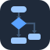 | [**Stroomdiagram**](plugins/stroomdiagram) | Typ stappen met pijlen en keuzes in gewone tekst en krijg een net stroomschema met vormen, pijlen en labels. | document wijzigen |
|  | [**Tijdlijn**](plugins/tijdlijn) | Maak een nette tijdlijn uit regels met datum, titel en tekst, horizontaal of verticaal. | document wijzigen |
|  | [**Venn-diagram**](plugins/venn) | Maak een Venn-diagram met twee tot vier verzamelingen, overlappen als echte eigen vlakken en tekst per vlak. | document wijzigen |
|  | [**Willekeurig**](plugins/willekeurig) | Geef elk geselecteerd object een eigen kleine afwijking in plek, draaiing, grootte, dekking of kleur, met een zaadje om terug te halen. | selectie lezen, document wijzigen |

### Hulpmiddelen

| | Plugin | Wat hij doet | Mag |
|---|---|---|---|
|  | [**Boekomslag**](plugins/boekomslag) | Teken de complete indeling van een boekomslag, met de rugdikte berekend uit pagina's, papier en bindwijze. | document wijzigen |
| 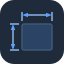 | [**Maatlijnen**](plugins/maatlijnen) | Zet maatlijnen met pijlpunten en een maatlabel in mm, cm of inch bij de geselecteerde objecten. | selectie lezen, document wijzigen |
|  | [**Meten**](plugins/meten) | Meet de echte oppervlakte, omtrek en snijlijnlengte van je selectie, met totalen en een label ernaast. | selectie lezen, document wijzigen |
| 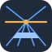 | [**Perspectiefraster**](plugins/perspectief) | Teken een perspectiefraster met 1, 2 of 3 verdwijnpunten en zet platte paden op een vlak in perspectief. | selectie lezen, document wijzigen |

## Een plugin maken in 5 minuten

**1. Fork en clone deze repo,** en maak een map met de naam van je plugin. De
naam bestaat uit kleine letters, cijfers en streepjes:

```sh
git clone https://github.com/<jij>/vexel-plugins
cd vexel-plugins
mkdir plugins/hallo-cirkel
```

**2. Schrijf het manifest,** `plugins/hallo-cirkel/plugin.json`:

```json
{
  "id": "hallo-cirkel",
  "naam": "Hallo cirkel",
  "beschrijving": "Zet een cirkel van 20 mm midden op het tekengebied.",
  "auteur": { "naam": "Jouw Naam", "github": "jouw-gebruikersnaam" },
  "licentie": "MIT",
  "categorie": "vormen",
  "rechten": ["document.schrijven"],
  "commandos": [{ "id": "maken", "titel": "Cirkel maken" }]
}
```

**3. Schrijf de code,** `plugins/hallo-cirkel/plugin.js`:

```js
'use strict';

vexel.opCommando('maken', async () => {
  const doc = await vexel.document();
  const r = vexel.mm(10);
  await vexel.maak([{
    soort: 'ellips',
    cx: doc.tekengebied.b / 2,
    cy: doc.tekengebied.h / 2,
    rx: r,
    ry: r,
    vulling: doc.kleurruimte === 'cmyk' ? { cmyk: [0, 60, 100, 0] } : { hex: '#ff8a1f' },
  }]);
  vexel.melding('Cirkel gemaakt', 'ok');
  vexel.sluit();
});
```

Dit commando heeft geen venster, dus het draait onzichtbaar en sluit zichzelf
met `vexel.sluit()`. Wil je een venster met velden, geef het commando dan een
`venster` en een titel die eindigt op `…`. Kijk in [docs/api.md](docs/api.md)
of in de drie plugins hierboven hoe dat gaat.

**4. Voeg een icoon en een README toe.** `icoon.svg` is een vierkante SVG
zonder tekst, script of externe verwijzingen, hooguit 16 KB. In `README.md`
leg je uit wat de plugin doet, hoe je hem gebruikt en waarom hij elk recht
nodig heeft. Wil je in de winkel een groot plaatje bij je plugin, voeg dan
ook een `voorbeeld.svg` toe: dezelfde regels als het icoon, maar de verhouding
is vrij (liefst 16:10, bijvoorbeeld `viewBox="0 0 320 200"`) en hooguit 40 KB.

**5. Controleer en probeer hem uit.**

```sh
node tools/valideer.mjs plugins/hallo-cirkel
```

Je hebt alleen Node.js 20 of nieuwer nodig. De controle is dezelfde als in CI
en noemt bij elke fout het bestand en de regel.

Probeer de plugin daarna uit in de proefbank:

```sh
node tools/proefbank.mjs plugins/hallo-cirkel
```

en open http://localhost:4321. Je ziet een tekengebied, je commando's en een
logboek van wat de plugin doet. De plugin draait daar net als in Vexel: in
een afgeschermd venster, met dezelfde API en dezelfde controles op vormen,
kleuren en rechten. Pas je `plugin.js` aan, klik dan gewoon opnieuw op het
commando. Je hebt er geen Vexel-account voor nodig.

Heb je wel een account, probeer hem dan ook in Vexel zelf: **Plugins › Plugin
uitproberen…** en kies `plugin.json`, `plugin.js` en (als je wilt)
`icoon.svg` tegelijk. Hij draait dan alleen bij jou en staat in het menu
Plugins met "(proef)" erachter. Werkt alles, open dan een pull request.

## Hoe publiceren werkt

Er is geen aparte publicatiestap en niemand hoeft een versienummer op te hogen.

1. **Pull request.** Je opent een PR met je map in `plugins/<id>/`.
2. **Controle.** GitHub Actions draait meteen de controle (`controle`): het
   manifest, de bestanden, de grootte, het icoon en de code. Die moet groen
   zijn.
3. **Review.** Een beheerder leest je code, je README en de rechten die je
   vraagt. Wat er gecontroleerd wordt, staat in [CONTRIBUTING.md](CONTRIBUTING.md#wat-de-review-controleert).
4. **Merge.** Na de merge bouwt GitHub Actions de index en de galerij en zet
   ze op GitHub Pages. Binnen een paar minuten staat je plugin in Vexel.

Elke plugin krijgt een `hash` die uit het manifest en de code wordt berekend.
Verander je iets, dan verandert de hash, en Vexel ziet dat er een nieuwe versie
is.

Gaat er iets mis met een plugin, dan komt hij in `ingetrokken.json`. Vexel
zet een ingetrokken plugin meteen uit, ook als hij al geïnstalleerd is.

## Veiligheid

Wat een plugin wel en niet kan, in gewone woorden:

- **Hij draait in een afgeschermd venster.** Vexel start elke plugin in een
  sandbox: een eigen, losstaande omgeving zonder cookies.
- **Hij heeft geen internet.** Een plugin kan niets downloaden en niets
  versturen, dus ook je tekening niet. Netwerkfuncties zijn geblokkeerd
  (ook WebRTC), en zijn venster kan niet naar een andere site.
- **Hij komt niet bij je account of je andere projecten.** Een plugin ziet
  alleen het document waarin je hem start, en alleen via de API: de naam, de
  maat en de kleurruimte, en met het juiste recht je selectie.
- **Hij kan alleen wat zijn rechten toestaan.** Zonder `selectie.lezen` ziet
  hij je selectie niet; zonder `document.schrijven` kan hij niets tekenen of
  wijzigen; zonder `beeld.lezen` en `beeld.schrijven` kan hij de pixels van
  je foto's niet lezen of vervangen. Wat een plugin verandert, kun je ongedaan maken zoals elke
  andere wijziging.
- **De code wordt gelezen.** Voordat een plugin hier verschijnt, controleert
  CI hem automatisch en leest een beheerder de code. De controle weigert onder
  meer `eval`, netwerkfuncties, verstopte code en geminificeerde code, zodat
  wat er staat ook te lezen is.

Geen van die maatregelen is op zichzelf waterdicht; samen maken ze het
moeilijk om iets kwaads te doen en makkelijk om het te zien. Vind je toch een
gat, meld het dan zoals in [SECURITY.md](SECURITY.md) staat.

## Deze repo

```
plugins/<id>/          één map per plugin: plugin.json, plugin.js, icoon.svg, README.md (en LICENSE, voorbeeld.svg)
ingetrokken.json       plugins die niet meer gebruikt mogen worden
tools/valideer.mjs     de controle (dezelfde als in CI)
tools/proefbank.mjs    een plugin uitproberen zonder Vexel-account
tools/bouw-index.mjs   bouwt _site/: index.json, de code per hash en de galerij
tools/test.mjs         tests voor de controle, met foute voorbeelden in tools/testgevallen/
tools/merken.json      merknamen van anderen (als hash) die niet in een plugin mogen staan
docs/api.md            de API, het manifest en het indexformaat
```

| Commando | Wat het doet |
|---|---|
| `node tools/valideer.mjs` | controleert alle plugins; met een pad alleen die map |
| `node tools/test.mjs` | test de controle zelf |
| `node tools/bouw-index.mjs` | controleert en bouwt `_site/` zoals GitHub Pages hem krijgt |

De index staat op `https://guuslab.github.io/vexel-plugins/index.json`. Het
formaat en hoe de hash berekend wordt, staan in [docs/api.md](docs/api.md#de-index).

## Licentie

De tools en de plugins van GuusLab vallen onder de [MIT-licentie](LICENSE).
Elke plugin noemt zijn eigen licentie in `plugin.json`; is dat niet MIT, dan
staat de licentietekst in de map van die plugin.
